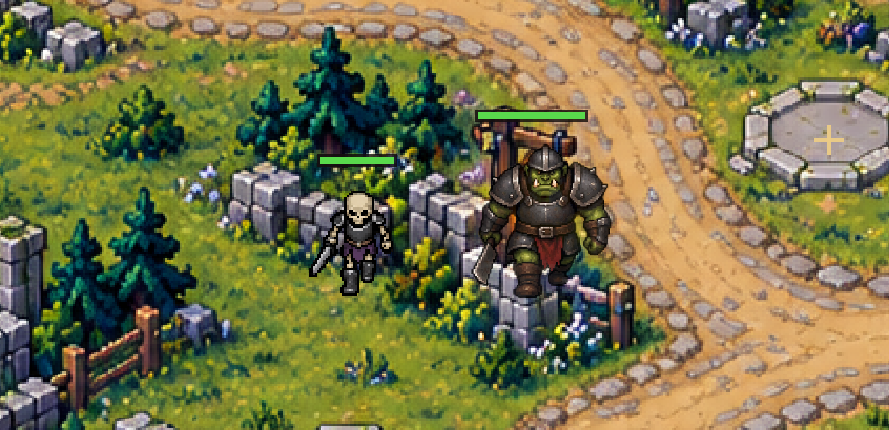

# RoyalFortress TD · 王国边境塔防

Unity 2D 塔防课程协作工程。包含同学制作的地图、法师塔与冰霜塔，以及骷髅兵和重甲兽人。

## 打开项目

1. Fork 本仓库，Clone 自己的 Fork。
2. 在 Unity Hub 中添加仓库根目录（直接包含 Assets、Packages、ProjectSettings）。
3. 使用 **Unity 6000.3.27f1** 打开，等待依赖下载和资源导入。
4. 双击 `Assets/Scenes/RoyalFortressGameplay.unity`，点击 Play。
5. 点击地图石台加号，选择箭塔、投石塔、法师塔或冰霜塔，再开始波次。

首次打开会重新生成 Library，耗时取决于网络和电脑性能。

## 当前功能

- 固定路线、7 个建塔位、三波敌人、墓穴支路和基地生命。
- 箭塔自动索敌，快速发射单体箭矢（低穿甲）。
- 投石塔投掷石块，命中后对小范围敌人溅射伤害。
- 法师塔自动索敌，发射穿甲追踪飞弹。
- 冰霜塔对范围内全部敌人减速 45%，离开范围恢复。
- 两种敌人的四方向行走、血条、受击闪色、减速反馈和死亡淡出。
- 击败计数、胜负结算、重开、地图缩放和平移。

| 敌人 | 生命 | 护甲减伤 | 移速 | 漏过扣生命 |
|---|---:|---:|---:|---:|
| 骷髅兵 | 125 | 15% | 1.25 | 1 |
| 重甲兽人 | 320 | 60% | 0.72 | 2 |

第一波4只骷髅；第二波4只骷髅和2只兽人；第三波5只骷髅和3只兽人。数值为起步配置，尚未完成完整关卡平衡。建塔目前免费，金币与升级尚未接入。

## 修改与协作

- 敌人配置：`Assets/Data/Enemies/`。
- 敌人预制体：`Assets/Prefabs/SkeletonEnemy.prefab`、`ArmoredOrcEnemy.prefab`。
- 地图使用的塔：`Assets/Prefabs/IntegratedTowers/`。
- 先建立自己的功能分支，再通过 Pull Request 合并；避免多人同时修改同一个场景。
- 提交资源时务必同时提交 `.meta`，不要提交 Library、Temp、Logs 和个人 IDE 配置。

详见 [Fork 协作说明](Docs/GitHubCollaboration.md)、[敌人交付说明](Docs/EnemyDelivery.md)、[双塔接入说明](Docs/TwinTowersIntegration.md)和[验证记录](Docs/EnemyVerification.txt)。`Docs/计划文档.docx` 为原始策划。

## 素材与验证范围

地图和骷髅沿用同学提供的工程，双塔来自同学的独立模块。兽人素材由内置 image_gen 工具生成，为像素风透明图，提示词保存在 [ArmoredOrcArtPrompt.txt](Docs/ArmoredOrcArtPrompt.txt)。死亡表现为程序动画。

在 Unity 6000.3.27f1、URP 2D 编辑器中验证了混合波次、伤害、减速、击杀、漏怪和重开。没有执行本版独立程序构建或其他平台验证。历史地图教程保留供参考，其中旧功能说明和作者机器路径以本页及新版交付说明为准。
